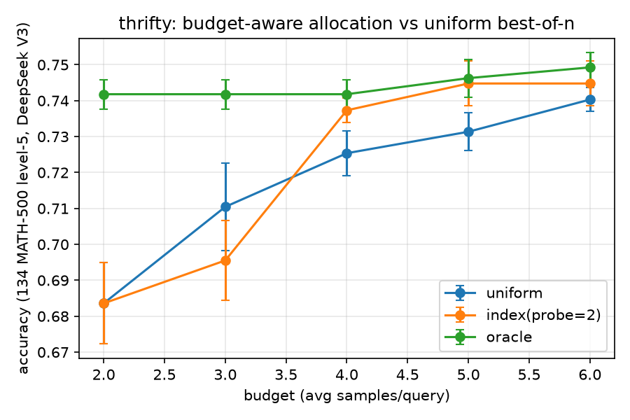

# thrifty

**Budget-aware test-time compute allocation for LLMs.** Reach a target accuracy
with fewer samples by spending your sampling budget where it buys the most:
hard-but-doable queries get more samples, trivial and hopeless ones get fewer.
Backend-agnostic — any OpenAI-compatible API or a local vLLM/SGLang server.

> **Status: v0.2 — validated on a real API, now frozen.** Targets **verifiable**
> tasks (code, math, anything with a checker or reward model) where the metric is
> best-of-n / pass@b. On DeepSeek V3 / MATH-500 it saves ~33% of samples at
> matched accuracy; see [Results](#does-it-actually-save-real-model-deepseek-v3-on-math-500)
> and [Project status](#project-status).

## Why

Best-of-n is the default way to spend test-time compute, but it gives every query
the *same* number of samples — wasteful. Easy queries are solved on the first
sample; hopeless ones never get solved; the queries that actually benefit from
more samples are a minority. `thrifty` estimates each query's difficulty and
water-fills the budget toward where extra samples convert to accuracy.

The allocation rule is the closed-form optimum for the pass@b production function
`1 − (1−μ)^b`, not a hand-tuned threshold — and it is *second-order robust* to
errors in the difficulty estimate (a fixed-threshold router is not). See
[`docs/THEORY.md`](docs/THEORY.md).

## Install

```bash
pip install -e .          # zero required dependencies (stdlib only)
pip install -e ".[openai]"  # to use the OpenAI-compatible backend
```

## 30-second tour (offline, no API key)

```python
from thrifty import BudgetRunner, MockBackend, accuracy

mus  = {f"q{i}": mu for i, mu in enumerate([0.05, 0.3, 0.4, 0.85, 0.9])}
gold = {p: "CORRECT" for p in mus}
backend = MockBackend(mus)

runner = BudgetRunner(backend, strategy="index",
                      verifier=lambda a: a == "CORRECT")
res = runner.run(list(mus), budget=4.0)     # avg 4 samples/query
print(accuracy(res, gold), res.total_samples)
```

## Real backend

```python
from thrifty import BudgetRunner, OpenAIBackend

backend = OpenAIBackend(model="gpt-4o-mini")          # or base_url=local vLLM
runner = BudgetRunner(
    backend, strategy="index", probe=2,
    verifier=my_checker,        # e.g. runs unit tests / checks the boxed answer
)
result = runner.run(prompts, budget=8.0)
```

`strategy="uniform"` gives the best-of-n baseline for comparison. The verifier
may also be prompt-aware — `(prompt, answer) -> bool`, detected by arity — which
is what per-problem gold answers need. Servers that reject `n > 1` (DeepSeek,
for one) are handled by `OpenAIBackend(..., n_per_request=1)`, which draws the
samples as concurrent single-sample requests; `prompt_tokens` /
`completion_tokens` accumulate real usage for token-denominated cost accounting.

## Does it actually save? (real model: DeepSeek V3 on MATH-500)

134 level-5 problems, `deepseek-chat`, best-of-n with a boxed-answer verifier,
5 reps (mean ± sd). Reproduce with
[`examples/bench_deepseek.py`](examples/bench_deepseek.py) and
[`examples/sweep_reps.py`](examples/sweep_reps.py); total API cost was ≈ $1, and
the raw generations are committed under `examples/data/cache/` so the tables can
be re-derived with no API key at all. Full write-up: [`RESULTS.md`](RESULTS.md).



| budget (avg samples/query) | 2 | 3 | 4 | 5 | 6 |
|---|---|---|---|---|---|
| uniform | .684±.011 | .710±.012 | .725±.006 | .731±.005 | .740±.003 |
| index (probe=2) | .684±.011 | .696±.011 | **.737±.003** | **.745±.006** | .745±.006 |
| index (oracle μ) | .742±.004 | .742±.004 | .742±.004 | .746±.005 | .749±.004 |

Two headlines:

- **The free probe signal saves ~33% of samples.** Index at budget 4 (.737)
  matches uniform at budget 6 (.740). The probe is free because its samples are
  reused in the final answer, and with a verifier it estimates difficulty from
  the *unbiased* probe pass rate.
- **A perfect difficulty signal would save 3×.** Oracle-μ allocation reaches
  uniform's budget-6 accuracy at budget 2. The allocator is not the bottleneck —
  the difficulty signal is. That gap is the case for a learned predictor.

Below budget 4 the probe's fixed cost isn't amortised and index degrades to (or
slightly below) uniform; with `probe=4` and budget ≤ 4 the probe consumes the
entire budget and index equals uniform *by construction*. Small probes win when
budgets are small. `examples/demo_mock.py` reproduces the same qualitative
picture offline, for free.

## How it works (one paragraph)

A query with per-sample success probability `μ` has `pass@b = 1 − (1−μ)^b`. The
budget-constrained optimum is `b*(ν;λ) = max(0, ln(ν/λ)/ν)` with `ν = −ln(1−μ)`
and `λ` (the shadow price of compute) set to exhaust the budget — hump-shaped:
abandon the hopeless, barely touch the trivial, concentrate on the middle. The
integer version is greedy on marginal gain (`core.index_allocate`). The same
shadow-price re-clearing is what makes the rule robust to difficulty-estimate
noise.

## Reproducing the benchmark

```bash
pip install -e ".[openai,dev]"
export DEEPSEEK_API_KEY=sk-...          # or DEEPSEEK_KEY_FILE=/path/to/key.txt

python examples/bench_deepseek.py --download-only        # fetch MATH-500
python examples/bench_deepseek.py --dry-run --n 40       # cost estimate, no spend
python examples/bench_deepseek.py --pilot --n 40 --levels 5   # difficulty histogram
python examples/bench_deepseek.py --n 134 --levels 5 --budget 6
python examples/sweep_reps.py                            # error bars + plot
```

Pilot first. The savings depend entirely on there being a difficulty spread: if
the model solves nearly everything on the first sample, there is nothing to
allocate. DeepSeek V3 on mixed MATH level 4–5 solves ~75% at one sample (useless
for this purpose); level 5 alone gives a usable spread. `--pilot` prints the
estimated μ histogram so you can check before spending.

## Limitations

Verifiable tasks only (needs a `verifier`); allocates sample count, not thinking
tokens; the self-consistency difficulty signal is a coarse fallback when no
verifier is available; savings depend on the difficulty spread and quality bar.
Verifier quality is load-bearing in a way that is easy to underestimate — the
difficulty estimate inherits every verifier false negative, so a normalisation
bug makes the allocator abandon solvable queries. Three such bugs (`x=5` vs `5`,
unordered solution lists, `\sqrt2` vs `\sqrt{2}`) turned up in this benchmark's
own verifier; `thrifty/mathv.py` is a pragmatic stdlib checker, and
paper-grade grading should swap in something like `math_verify`.

## Roadmap (not being pursued — see Project status)

- **v0.3** learned difficulty predictor trained decision-focused (LANCER-style),
  for the low-budget regime and non-verifiable tasks — the 3× oracle gap.
- **v0.3** majority-vote production function (no verifier) — a different
  allocation law (`1 − (1−μ)^b` is the wrong objective there).
- **v0.4** model routing (cheap/expensive) as part of the allocation;
  token-denominated rather than sample-count budgets.
- **v0.5** sequential early-stopping within a reasoning trace; first-class local
  vLLM/SGLang integration.

## Related work (as of 2026)

Difficulty-aware allocation of test-time compute is an active research area.
This library's contribution is a clean, pip-installable, backend-agnostic
implementation with a closed-form allocation rule and a robustness analysis —
not algorithmic novelty. Closest neighbours: batch allocation via training-free
difficulty proxies ([OpenReview](https://openreview.net/forum?id=ztGHhyicWs))
and Difficulty-Adaptive Self-Consistency
([arXiv:2408.13457](https://arxiv.org/abs/2408.13457)); sample-count-aware model
routing ([BEST-Route](https://arxiv.org/abs/2506.22716)); allocation under
costly verification ([AGRV](https://arxiv.org/abs/2605.17609)); per-query
token-level early stopping ([Dynasor/Certaindex](https://github.com/hao-ai-lab/Dynasor));
per-question sequential stopping
([AdaptiveConsistency](https://github.com/Pranjal2041/AdaptiveConsistency)); the
compute-optimal scaling framework
([arXiv:2408.03314](https://arxiv.org/abs/2408.03314)) and pass@k scaling laws
([arXiv:2407.21787](https://arxiv.org/abs/2407.21787)). The same allocation
question appears on the RL-training side as rollout allocation across prompts:
[Pilot-Commit](https://arxiv.org/abs/2605.26606), DAPO's dynamic sampling, and
successors. Frontier labs are meanwhile moving per-query *token* allocation
inside the model via effort-based reasoning controls, which narrows the
external-allocator niche to verifier-based best-of-n, batch evaluation, and
orchestration — exactly what this library targets.

## Project status

**Frozen (September 2026), and deliberately so.** The library works, is tested
in CI, and the results above are real and reproducible. But a 2026 literature
scan (above) found the batch-allocation idea already published, the RL-side
analogue already done, and labs absorbing token allocation into the models
themselves. The findings here independently reproduce the field's consensus —
concentrate on middle difficulty, ~3× headroom for a better difficulty signal,
a probe-amortisation boundary at low budgets — which makes this a good artifact
and a poor research bet. Extending it further would be motivated reasoning, so
the roadmap above stays unbuilt. Issues and forks welcome if it is useful to
you.
